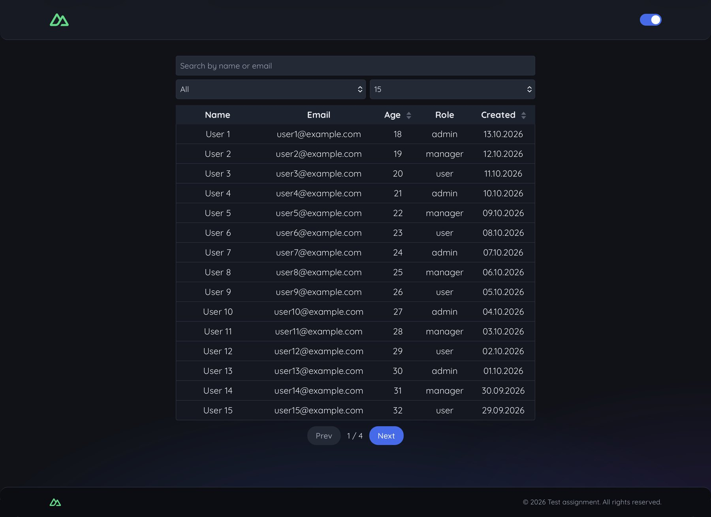
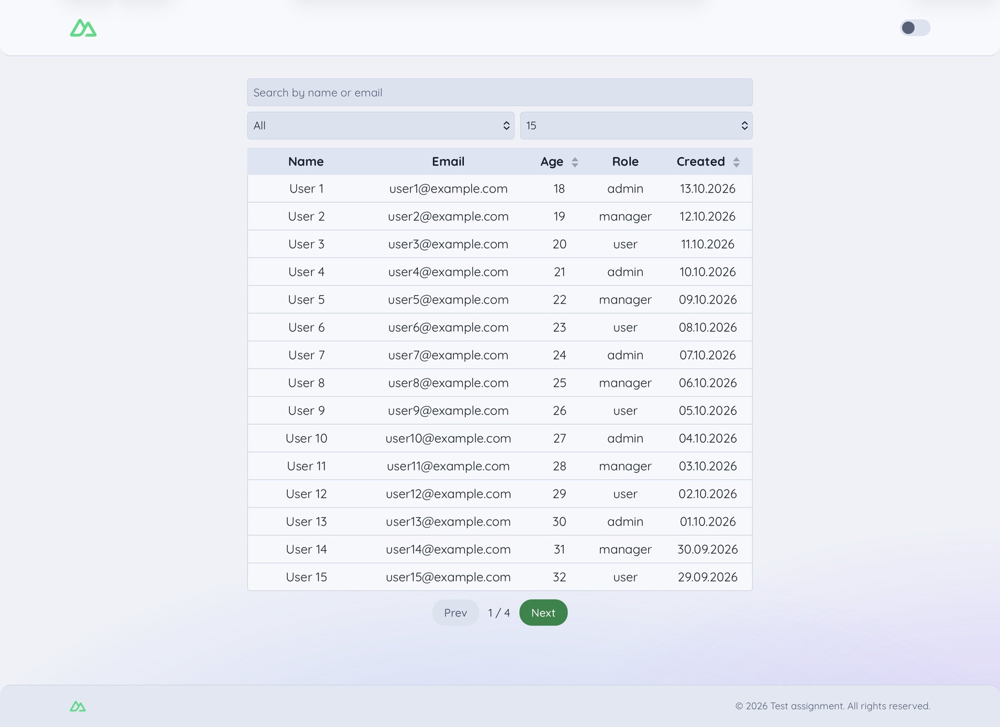
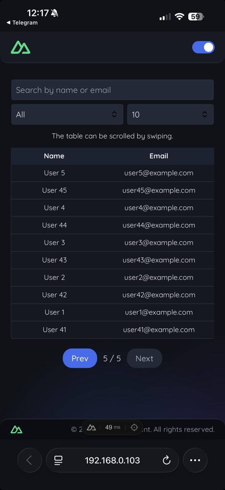
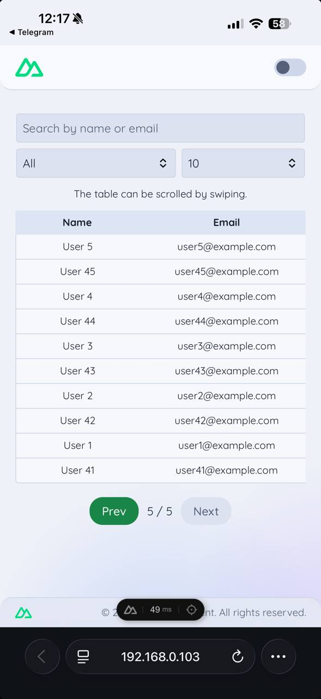

# Users table — test assignment

A users table built with Nuxt 4 and Vue 3: search, role filter, sorting and pagination over a local list of 50 generated users, with a dark and a light theme.

## Screenshots

| Dark theme                                                                          | Light theme                                                                           |
| ----------------------------------------------------------------------------------- | ------------------------------------------------------------------------------------- |
|                            |                            |
|  |  |

## Getting started

Requires Node.js 22.22 or newer (developed on v24).

```bash
npm install
npm run dev      # http://localhost:3000
```

Other scripts:

| Script                 | What it does                                |
| ---------------------- | ------------------------------------------- |
| `npm run dev:host`     | Dev server reachable from the local network |
| `npm run build`        | Production build                            |
| `npm run preview`      | Serve the production build locally          |
| `npm run format`       | Format the code with Prettier               |
| `npm run lint:css`     | Check the order of CSS properties           |
| `npm run lint:css:fix` | Reorder CSS properties automatically        |

## Features

- **Search** by name or email, case-insensitive, debounced by 400 ms.
- **Filter** by role (admin, manager, user).
- **Sorting** by age and by creation date; a click on the same column flips the direction, and an arrow in the header shows it.
- **Pagination** with 10, 15 or 20 rows per page, or all rows at once. Changing a filter or the sorting returns to the first page.
- **State in the URL.** Search, role, sorting, page and page size are written to the query string, so a link reopens the table in the same state. Default values are left out to keep the URL short.
- **Dark and light theme** with a switcher in the header. The choice is kept in a cookie until the browser is closed.
- **Sticky table header.** On tablet and desktop the page scrolls and the header row stays pinned right under the filters. Below 768 px the table needs horizontal scrolling, so it gets a limited height and scrolls inside its own area, with the header pinned to the top of that area.
- **Sticky filters.** The search field and the selects stay at the top of the screen while the page scrolls.

## Decisions

- **Table logic lives in one composable.** `useUsersTable` owns filtering, sorting, pagination and the URL sync. Components only render what they receive and emit events.
- **Themes are CSS custom properties.** `_theme.scss` defines the values for both themes; the SCSS variables in `_variables.scss` point to them. Components keep using `$color-*` and know nothing about the active theme.
- **Cookie instead of `localStorage` for the theme.** The page is server-rendered, and the server can read a cookie. The HTML arrives with the right theme class, so there is no flash of the wrong theme on load.
- **Two gradient layers for the background.** A gradient cannot be transitioned, so each theme has its own layer and they cross-fade.
- **Real `<table>` with `table-layout: fixed`.** Column widths are fixed and long values are cut with an ellipsis, which renders the same in Chrome and Safari.
- **The font is served locally** from `public/fonts`, with no requests to third-party hosts.

## Project structure

```
components/    UI components (table, filters, select, sort arrow, theme switcher, header, footer, logo)
composables/   useUsersTable — table state and logic; useDebouncedRef — debounced copy of a ref
constants/     Roles, sort directions, page size options
data/          Generated list of users
layouts/       Default layout: header, footer, theme state
pages/         The only page, wires the composable to the components
styles/        Global styles
  _theme.scss      Color values for the dark and the light theme
  _variables.scss  Breakpoints, sizes and SCSS aliases for the theme colors
  _mixins.scss     Breakpoint, container, truncate and flex helpers
  _reset.scss      CSS reset
  _base.scss       Body, background gradients, shared input styles
  _buttons.scss    Button styles
  _fonts.scss      @font-face rules for Quicksand
types/         TypeScript types for a user and the sort key
```

## Known limitations

- Sorting works with a mouse or touch only; the column headers do not react to Enter or Space.
- The search field and the two selects have no accessible labels.
- Components are written in plain JavaScript; only the composables and types use TypeScript.
- There are no automated tests.
